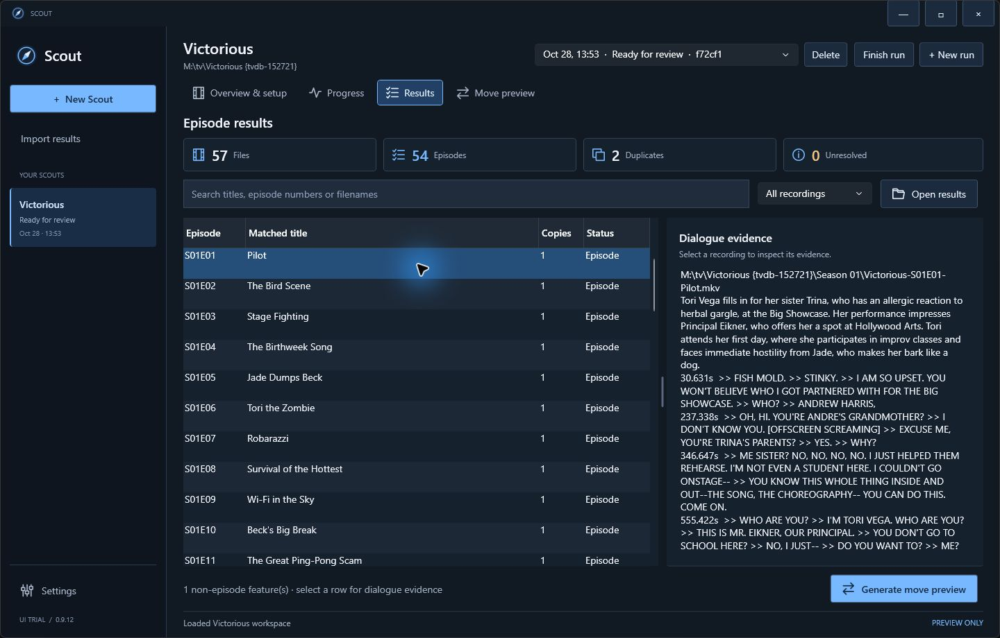
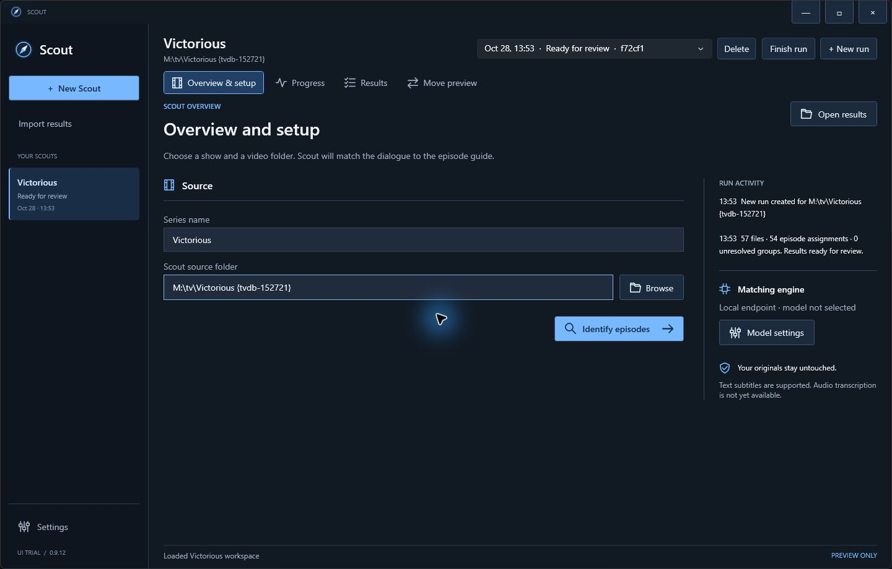

# Scout

A Windows desktop app for identifying TV episodes from video dialogue, reviewing the evidence, and organizing files into episode names and season folders.

## Features

- One saved process per Scout, tied to a source video folder. Pause, resume, review issues, or identify newly added files without repeating successful work.
- Show discovery from folder names, filenames and embedded metadata. Confirm catalog hints directly, or ask AI to verify sample dialogue.
- TVDB, TMDB and TVmaze title/ID lookup and episode-guide downloads.
- Confirm the series without loading a model; choose any subset of episodes for AI dialogue identification.
- Choose one episode, one season, the full show or a custom multi-selection.
- Verify two consecutive episodes in one recording, or one episode split across two recordings, with distinct combined/split previews and duplicate handling.
- Full-dialogue matching with a second verification pass and original evidence.
- Exact recording duplicates grouped together; competing recordings held as unresolved conflicts.
- Local model endpoints or a managed local runtime, with optional cloud providers.
- Settings for model downloads, usage, and API keys, with encrypted Windows credentials and explicit opt-in for cloud dialogue and downloads.
- Cached rename/move previews, selective moves, and separate handling for duplicates and non-episode features. Saved analysis follows moved files.
- Preserve correct names by default, or use one relative-path template with dot-chained formatting, syntax highlighting, and completion. Global naming settings apply to every Scout.
- Preview reasons distinguish formatting-only changes, folder moves, episode corrections, and unchanged files.
- Searchable episode results and a draggable divider to give dialogue evidence more room.
- SQLite storage for settings, evidence, results, and history, plus Scout deletion with undo and Windows taskbar shortcuts.

## Screenshots

### Episode results and dialogue evidence

Review matched episode numbers and titles alongside the dialogue that supports each match.



### Scout overview and setup

Keep the source folder, metadata provider, series selection, and activity together in one Scout.



## Current limits

Identification and preview generation do not change source media. The move preview can explicitly apply checked rename/move operations; files are never overwritten or deleted. Audio transcription is not implemented. Embedded text subtitles are supported; saved dialogue can be supplied as an advanced override. Episode guides can be downloaded from a selected metadata provider or imported under Settings > Usage and tools > Advanced run data.

FFmpeg/FFprobe are supplied separately. Managed local runs automatically install the pinned llama.cpp b11908 Windows x64 runtime for the Qwen3.6 and Gemma profiles when downloads are enabled. Scout verifies the archive SHA256, installs the executable with its libraries, and verifies installed files before reuse. Zero GPU layers uses CPU; other values select Vulkan and require a compatible graphics driver. Settings also offers a runtime-only download. Scout always manages the llama-server executable when launching a model. Custom GGUF models are not automatically guaranteed compatible. Downloads stay in Settings and can be cancelled without adding events to a Scout run. Experimental model downloads require opt-in; no model is universally approved. Cloud requests require separately configured credentials and can incur provider charges. Saved-evidence benchmarks compare model decisions against inherited references; neither those references nor synthetic fixture tests establish independent real-world accuracy.

## Show discovery and episode identification

In **Overview and setup**, choose the source folder first, then the metadata provider:

- **TheTVDB** (default): API key, plus subscriber PIN when required by the key type. Uses TVDB series IDs and the provider's default episode order.
- **TMDB**: API Read Access Token. Uses TMDB TV series IDs and season/episode numbering.
- **TVmaze**: no API key. Uses TVmaze show IDs and numbering.

Configure credentials under **Settings > Show discovery**. Credentials are encrypted for your Windows account. Provider IDs are separate namespaces; a TMDB or TVmaze ID is never treated as a TVDB ID.

**Identify series** checks folder names, filename prefixes, provider ID tags, and embedded series tags against the selected catalog. Review the suggestions and choose **Use this show** to confirm without loading a model, or choose AI assistance. Scout automatically samples up to two videos for discovery; these samples do not limit the episodes you can identify later. AI checks compact original-dialogue excerpts against catalog candidates and expands inconclusive evidence when needed. IDs always come from the provider. Remakes, mixed shows, or missing evidence can remain unresolved.

**Identify episodes with AI** opens the scope picker for one episode, a season/folder, the full show, or a custom selection. Previous identification selections are preselected. Cancel closes the picker without starting processing. Scout downloads a missing guide for the selected show, saves its own snapshot, and matches each selected recording against it. Results, dialogue, checkpoints, usage, and exact-input model caches stay with the Scout.

To start an independent analysis, choose **New Scout**, including when reusing the same source folder. To continue an existing analysis, use **Resume Scout**, **Review issues**, or **Reanalyze Scout**. Provider numbering can differ; each Scout retains the identity and guide used for its results. Saved guides can be imported under **Settings > Usage and tools > Advanced run data** and must match the selected provider and series.

Provider documentation and attribution: [TheTVDB v4](https://thetvdb.github.io/v4-api/), [TMDB](https://developer.themoviedb.org/docs/getting-started), [TVmaze API](https://www.tvmaze.com/api). This product uses the TMDB API but is not endorsed or certified by TMDB. TVmaze data is provided under [CC BY-SA](https://creativecommons.org/licenses/by-sa/4.0/). Provider access and distribution terms apply; no shared API keys are bundled.

## Naming preferences

Open **Settings > Naming** to choose naming preferences for all Scouts. Preserve mode accepts equivalent spacing, punctuation, and season-folder numbering when the episode number and title agree with the match. Unrecognized names receive an episode-naming proposal; contradictory episode information is marked as a correction.

Use one relative path template for both folders and filename. It includes the series, episode identity, and title, with optional provider/ID tags and transformations applied only where requested. Scout adds the source extension. See [Naming path language](#naming-path-language) for an example and supported functions.

Saving naming preferences updates the preview without running the model. Cosmetic changes remain distinct from episode corrections; files change only when their moves are explicitly selected and applied.

## Combined and split recordings

Dialogue matching can assign two consecutive catalog episodes from the same season to one file. Both require distinct supporting blocks in playback order and an independent guide verification pass. Preview names use `S01E01-E02` and both titles. This is one combined assignment, not two competing guesses.

For a split episode, both files must be selected in the same identification run. Each must have dialogue evidence identifying it as a partial recording of the same episode. After collapsing exact copies, Scout compares the two full dialogue sources twice independently. Both checks must establish complementary story continuity and agree on order. Preview names include `(Part 1 of 2)` and `(Part 2 of 2)`. Files are retained separately; Scout does not concatenate or split media; each part can be moved or renamed separately from the move preview. Identical copies of either part remain duplicates. Overlapping dialogue, competing complete recordings, a missing half, three or more distinct contenders, or inconclusive verification remain unresolved.

Combined and split assignments appear separately in results, evidence and move previews. Combined files count both episodes; split files count one episode. Filename-only matching holds multi-episode ranges and part labels for dialogue review. Duration and filenames never prove multipart content. Current support is limited to two consecutive episodes per combined file and two recordings per split episode; larger or nonconsecutive combinations remain for review. Rerun identification to evaluate old results with the new matcher; old single-episode caches are not reused as multipart evidence. Fixture tests validate the workflow and safety checks; real-media model accuracy still needs benchmarking.

## Resume an interrupted Scout

Select the saved Scout and choose **Resume Scout**. Scout keeps its original file selection and episode guide, reuses successful model results and fingerprints for unchanged files, and retries failed, changed, or unfinished files with the current model settings. Successful files are checked against saved size, modification time, sampled digest, and guide identity before reuse. Missing files are reported individually without discarding other completed results. Existing unresolved model judgments remain available for review; restart does not force them into assignments.

Reports are checkpointed after each file. An interrupted model request must be repeated; completed results remain saved. Resuming does not rename or move media; changed results invalidate the cached move preview.

Each sidebar entry is one Scout with one saved process. Multiple Scouts can use the same source folder; choose **New Scout** to start another. **Resume Scout** continues the selected Scout using its saved selection and completed results. Existing saved runs appear as independent Scouts; their files and history are retained.

During dialogue identification, **Pause Scout** queues a pause immediately and shows a persistent acknowledgement. The current file finishes model verification and fingerprinting and is saved before Scout stops; it does not cancel the active model request. During split verification it finishes the current verification pair. **Resume Scout** continues from these saved checkpoints. Other activities, such as downloads or show discovery, retain their cancel action.

## Local SQLite storage

The Windows app stores settings, Windows-encrypted API credentials, Scout history, guide snapshots, dialogue, per-file results, fingerprints, model caches, usage, logs, and previews in `%LOCALAPPDATA%\Scout\scout.db`. SQLite may maintain its own journal/WAL files alongside it. Model downloads and managed runtime binaries remain in the configured model folder. Source videos are never stored in the database.

Fresh installations start directly with SQLite. Existing database contents remain in place across upgrades. Legacy loose files are not scanned or automatically imported; any retained files are inactive backups. Explicit report/guide import remains available. One app instance is allowed at a time. Browser previews are exported to a temporary folder only when explicitly opened. Developer command-line workflows can still read or explicitly export standalone reports.

The versioned schema uses document records for settings/history/guides/caches and a separate indexed `file_results` table for each report's file checkpoints. Credentials remain DPAPI-encrypted blobs. Reads and checkpoint replacements are transactional, with WAL and full synchronous writes. A newer unsupported schema is rejected rather than downgraded.

## Automated conflict review

After identification and split verification, Scout re-evaluates competing episode claims using each recording's original dialogue and the full episode guide. Two independent full-guide decisions must agree before replacing a suggestion. Filenames, earlier suggestions, and an assumption that one claimant must win are not model evidence. The collection resolver runs again afterward; duplicate claims are still held rather than forced into unique slots. Original suggestions remain in the audit data. Review progress is checkpointed, and errors or paused conflict reviews cannot become accepted assignments accidentally. The match-review panel lists the competing recordings.

**Reanalyze Scout** keeps the same file selection and saved guide, reuses dialogue and primary video/audio fingerprints for unchanged files, and reruns model analysis and independent verification with the current connection settings. It bypasses prior analysis caches and reevaluates combined, split, and conflicting assignments. Previous results are retained internally in SQLite; pending files are held until their fresh analysis completes. Pause and then Resume Scout continues this new analysis without repeating its successful files. Media files are never changed by analysis.

**Review issues** automatically selects unresolved, failed, invalid, or changed recordings and their competing recordings or copies. It reuses unchanged dialogue and fingerprints, runs two independent full-guide checks with the current model, and reevaluates split and duplicate/conflict assignments. Unrelated successful results are preserved. Newly competing recordings are included in the final conflict check. Evidence shows why each file was included; inconclusive results stay held. Pause and Resume Scout retain the issue-review scope. No manual corrections or media changes are made.

Right-click Scout’s Windows taskbar icon for **Ready for review** and **Recent Scouts**. Selecting an entry opens that Scout’s results in the existing window, or launches Scout when closed. During processing, the requested Scout opens after the current activity finishes or pauses. Windows taskbar history settings control whether custom Jump List categories are displayed.

## Naming path language

The template editor highlights fields, functions, strings, and character categories. Type an opening brace for field suggestions, a dot for functions, or press **Ctrl+Space** at the cursor. **Tab/Enter** inserts the selected suggestion; **Esc** dismisses it. Suggestions include examples and descriptions, and validation plus filename examples update as you edit. Editing is local and makes no model requests.

Settings uses one relative path template for folders and filename; Scout adds the source extension. Literal folder spaces are independent of filename transformations. For example:

~~~text
Season {season:00}\{series.replaceWhitespace(".")}.{code}.{titles.remove(punctuation).replaceWhitespace(".").join(".and.")}{partSuffix.remove(punctuation).replaceWhitespace(".").prefix(".")}
~~~

Tokens include series, code, title, titles, season/episode (optionally :00), provider, id, part, parts and partSuffix. Functions run left to right. Titles are a list: transformations before join apply to each title, and transformations afterward apply to the joined text.

- remove(punctuation), remove(symbols), remove(diacritics), remove(whitespace), remove(quotes) use defined character-category selectors.
- remove("text") removes literal text only, even when it spells a selector name.
- replaceWhitespace("."), replacePunctuation(" "), replace("&", "and"), lowercase(), uppercase(), trim(), prefix("text"), and suffix("text") provide explicit formatting.
- join(" and ") joins combined titles. Episode codes retain their range.
- partSuffix is empty for complete files or contains (Part 1 of 2), including a leading space. A split suffix is added automatically when no part token is present.

Functions use dot chaining. Arguments are readable double-quoted strings; quotes and backslashes inside them are escaped. Older pipe templates display as equivalent dot chains when opened in Settings; unknown functions/selectors are rejected. Braces escape as {{ and }}. Templates must stay relative, cannot traverse parent folders, and must include a season folder token, episode code and title. Windows-invalid filename characters are sanitized. Existing naming preferences are converted when opened in Settings. **Preserve correct names** remains the default; choose **Standardize all names** to apply purely cosmetic changes.

## Retained evidence and added videos

**Locate moved files** lets you select the current source folder. Scout also checks missing saved paths when resuming, reanalyzing, reviewing issues or identifying additions. Size and sampled hashes narrow candidates, then complete primary video/audio fingerprints verify the recording before reconnecting its saved analysis. Original paths and verified changes remain in the evidence history. Ambiguous copies remain held; no filename-based identity guessing or video changes occur.

**Identify new files** scans the selected Scout's source folder for added videos, identifies only those additions, and checks their assignments against saved results. New conflicts include their competing recordings in automated review; unrelated saved results (including older failures) stay unchanged. The incremental scope is checkpointed, so **Pause Scout** and **Resume Scout** continue that batch without repeating successes. This is an explicit scan, not a background folder watcher. Use Review issues or Resume Scout to retry older failures.

Move previews are cached in SQLite and restored across launches. Matching results, guide, naming preferences, series identity, source location, source file metadata and destination occupancy determine validity. **Regenerate preview** explicitly recalculates. Older previews without a cache signature need one regeneration. **Open full preview** launches Edge, Chrome or Firefox directly, preferring the recognized default HTTPS browser rather than the HTML file association.

The Windows template editor uses [AvalonEdit](https://github.com/icsharpcode/AvalonEdit), distributed under the MIT license. Its notice is included in THIRD-PARTY-NOTICES.txt.

## Apply selected moves

In **Move preview**, check individual files or choose **Select pending**, then click **Move / rename selected**. Only checked, unblocked rows are eligible. The status column distinguishes **Pending**, **Completed**, **Held**, **Unchanged**, and failed attempts that can be retried. The list updates after each file, and completed history stays available after reopening or regenerating the preview.

Scout revalidates the preview, source fingerprints and destination occupancy before applying changes inside the source folder. Same-volume renames use Windows file identity, saved size/time and small fingerprint samples (up to 192 KiB per sample check), with a read handle blocking concurrent writers. They do not reread entire videos or silently fall back to cross-volume copies, and never overwrite an existing destination. Selected dependencies are processed in order; unselected occupants and rename cycles stay held. Junctions/symbolic links are not traversed, and empty source folders are retained. Duplicate copies move into their own destinations; they are not deleted.

Each move's intent is saved in SQLite before the filesystem operation. Completion updates the recording path, path history and original analysis together. **Stop after current move** stops the batch while retaining completed work. After an interruption, **Regenerate preview** reconciles pending moves against destination identity and saved samples (a full saved-fingerprint check is used only for legacy journals or recovery on storage without file IDs); it does not automatically retry a filesystem move. Uncertain locations remain held. No model requests are needed to apply moves.

## Development

Scout is built with C# and WPF on .NET 11, using the prerelease SDK pinned in `global.json`.

### Build and run

On Windows, install the SDK selected by `global.json`, then run:

```powershell
./build.ps1
./artifacts/win-x64/Scout.exe
```

Pass `-DotnetPath C:\path\to\dotnet.exe` to use a particular SDK installation. The build runs the executable test suite and publishes a self-contained x64 app. End users do not need an installed .NET runtime.

### Package

```powershell
./package.ps1
```

Packaging produces a ZIP and SHA-256 file in `artifacts/releases`. Use `-SkipBuild` only after a successful build.

### Repository layout and tests

- `Scout.Core`: media pipeline, matcher, model transport, collection resolution, preview planner, settings and workspace persistence.
- `Scout.Desktop`: WPF application and Windows integration.
- `Scout.Tests`: executable regression suite with synthetic fixtures and mocked HTTP.
- `Scout.Core/Assets`: matcher prompts and JSON schemas.
- `Scout.Desktop/Assets`: mascot source PNG, application PNG and multi-resolution ICO.
- `scripts/Generate-Icon.ps1`: exports the dog mascot source artwork to PNG and multi-size Windows ICO without external graphics tools.

Run tests with:

```powershell
dotnet run --project Scout.Tests -c Release
# Optional live, key-free provider smoke test:
dotnet run --project Scout.Tests -c Release -- --metadata-smoke
```

### Local data

Scout stores preferences, history, and processing results in `%LOCALAPPDATA%/Scout/scout.db`. Set `SCOUT_WORKSPACES` to override the history location. `SCOUT_SETTINGS` overrides the desktop preferences directory for isolated testing.

Guides, results, usage, previews and events are stored under each Scout in SQLite, outside the source video folder. New Scouts retain their own guide snapshot. Do not commit media, transcripts, user reports, model weights, keys, or machine-specific settings.

### Automated recheck of saved model errors

For local inference, `dotnet run --project tools/Scout.Recheck -c Release -- "<run directory>" "<settings directory>"` revalidates saved assignments, reruns files with recorded model errors using the configured local model, and regenerates that run's report and move preview. It verifies current source files and reuses unchanged dialogue. It does not rename or move videos or manually assign episodes. Close the run in the UI while rechecking to avoid concurrent edits. An optional third argument writes the merged report and preview to a separate output directory, leaving the saved run untouched until those results are copied back.

Guide cards sent to the matcher include catalog season and episode numbers. Invalid model responses receive at most one retry per inference stage, within the configured request budget, with the original dialogue and a validation explanation. Failed attempts remain in the saved diagnostic evidence; unsupported results remain held. Collection validation checks selected assignments without treating rejected comparison candidates as additional assignments.

### Isolated model benchmarks

The `tools/` projects contain the automated model comparisons and diagnostic runners. See the [model comparison](tools/Scout.Benchmark/README.md), [decision-model evaluation](tools/Scout.JudgeBenchmark/README.md), [fast workflow](tools/Scout.FastBenchmark/README.md), and [compact verification benchmark](tools/Scout.VerificationBenchmark/README.md) instructions. Personal fixtures, transcripts, generated reports, databases, model weights, and Python caches are excluded from Git. Some diagnostic scripts use local experiment paths; review their inputs before running them.

Scout is licensed under the [MIT License](LICENSE).
