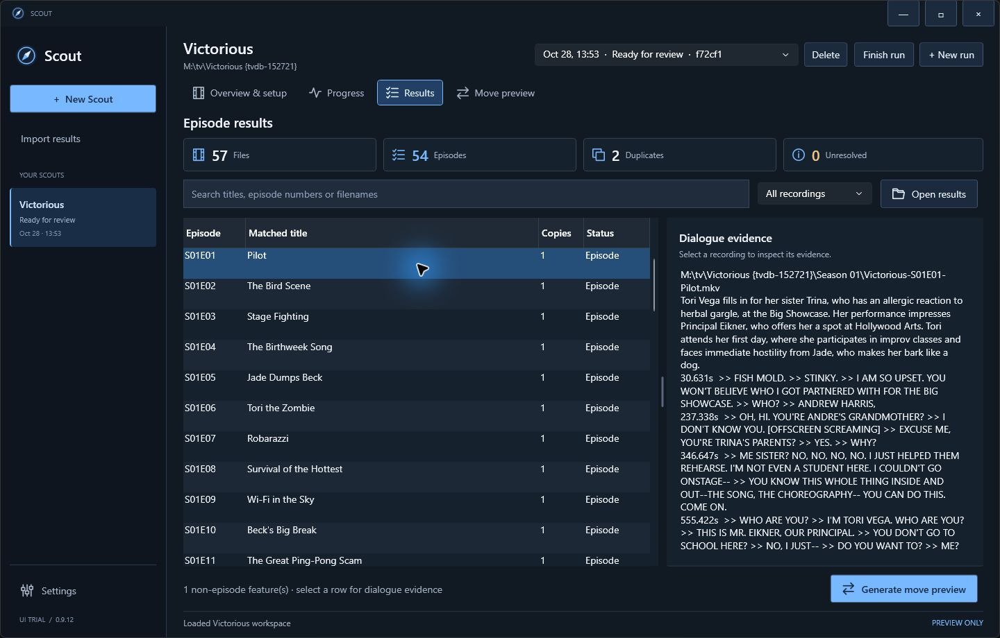
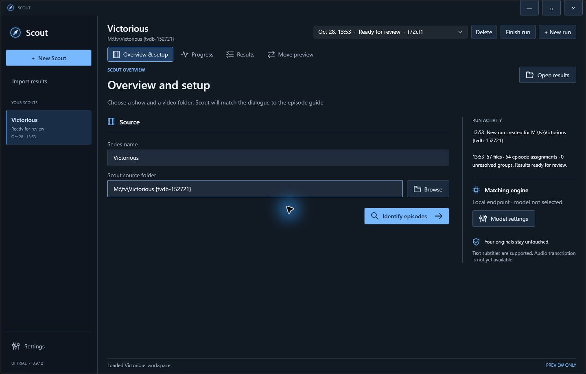

# Scout

A Windows desktop app for identifying TV episodes from video dialogue, reviewing the evidence, and planning episode names and season folders.

## Features

- One Scout per source video folder, with independent runs and saved history.
- Show discovery from folder names, filenames and embedded metadata, with automatic dialogue fallback when clues are inconclusive.
- TVDB, TMDB and TVmaze title/ID lookup and episode-guide downloads.
- A no-AI path from known show and filename episode numbers to rename/move previews.
- Choose one episode, one season, the full show or a custom multi-selection.
- Full-dialogue matching with a second verification pass and original evidence.
- Exact recording duplicates grouped together; competing recordings held as unresolved conflicts.
- Local model endpoints or a managed local runtime, with optional cloud providers.
- Settings for model downloads, usage, and API keys, with encrypted Windows credentials and explicit opt-in for cloud dialogue and downloads.
- Rename/move previews with separate handling for duplicates and non-episode features.
- Preserve correct names by default, or standardize with custom filename and season-folder templates. Global naming settings apply to every Scout and run.
- Preview reasons distinguish formatting-only changes, folder moves, episode corrections, and unchanged files.
- Searchable episode results and a draggable divider to give dialogue evidence more room.
- Run deletion from history with undo; artifacts are retained for recovery.

## Screenshots

### Episode results and dialogue evidence

Review matched episode numbers and titles alongside the dialogue that supports each match.



### Scout overview and setup

Keep the source folder, run setup, and activity together in one workspace.



## Current limits

Source media is never renamed, moved, or deleted; rename/move plans are previews only. Audio transcription is not implemented. Embedded text subtitles are supported; saved dialogue can be supplied as an advanced override. Episode guides can be downloaded from a selected metadata provider or imported under Settings > Usage and tools > Advanced run data.

FFmpeg/FFprobe are supplied separately. Managed local runs automatically install the pinned llama.cpp b11908 Windows x64 runtime for the Qwen3.6 profile when downloads are enabled. Scout verifies the archive SHA256, installs the executable with its libraries, and verifies installed files before reuse. Zero GPU layers uses CPU; other values select Vulkan and require a compatible graphics driver. Settings also offers a runtime-only download. Scout always manages the llama-server executable when launching a model. Custom GGUF models are not automatically guaranteed compatible. Downloads stay in Settings and can be cancelled without adding events to a Scout run. Experimental model downloads require opt-in; no model is universally approved. Cloud requests require separately configured credentials and can incur provider charges. Matcher accuracy still needs an end-to-end model benchmark; fixture tests and imported example results do not establish accuracy.

## Show discovery and known-show workflows

In **Overview & setup**, select a metadata provider. The visible **Known show · no AI** and **Discover from files** tabs separate the two workflows:

- **TheTVDB** (default): API key, plus subscriber PIN when required by the key type. Uses TVDB series IDs and the provider's default episode order.
- **TMDB**: API Read Access Token. Uses TMDB TV series IDs and season/episode numbering.
- **TVmaze**: no API key. Uses TVmaze show IDs and numbering.

Configure credentials under **Settings > Show discovery**. Credentials are encrypted for your Windows account. Provider IDs are separate namespaces; a TMDB or TVmaze ID is never treated as a TVDB ID.

**Already know the show?** Search its title or look up its numeric ID, review the year, and choose **Use this show**. **Match filenames to catalog (no AI)** uses the run’s saved guide when available, otherwise downloads it, and matches unambiguous season/episode numbers. It hashes files to detect exact byte-for-byte duplicates. It makes no model requests and does not verify video content; unclear numbering and conflicts stay unresolved. Generate a move preview to review proposed titles and locations. For offline use, choose **Use saved episode guide** and import a Scout `catalog.json`. It must contain a provider identity; older TVDB guides must include their TVDB source URL and series ID. Imported guides are labeled as saved snapshots, not live lookups, and a guide for a different provider or show is rejected.

**Unknown show?** Choose **Discover from files**. Folder names, filename prefixes, provider ID tags and embedded series tags are checked against the selected catalog. **Use dialogue…** is off by default; enable it to try the configured model when clues are inconclusive. Dialogue proposes show names, then independently checks catalog candidates against original subtitle excerpts. IDs always come from the catalog. Review candidates and evidence before selecting a show. Remakes, mixed shows and missing evidence may remain inconclusive.

Show discovery uses a compact picker limited to one or two sample episodes. The identification scope picker supports one episode, one season/folder (including nested disc folders), the full show, or a custom multi-selection. Discovery samples and identification selections are saved separately with the run. **Identify episodes** always opens the scope picker with the previous identification selection preselected; **Choose episodes to identify** also lets you adjust it ahead of time. **Identify episodes** automatically downloads a missing guide for the selected show before processing dialogue. Dialogue discovery samples up to 36 blocks per selected recording and uses bounded per-recording requests with cancellation and the configured request cap. Results, partial checkpoints, usage and exact-input model caches stay in the run. Discovery accuracy still requires a broader real-media benchmark.

Selecting a show on a completed run starts a new run. Existing results retain their original identity. The selected provider and ID are reused for new runs of that source folder. Provider numbering can differ: confirm the chosen provider/order before relying on filename-only matches.

Provider documentation and attribution: [TheTVDB v4](https://thetvdb.github.io/v4-api/), [TMDB](https://developer.themoviedb.org/docs/getting-started), [TVmaze API](https://www.tvmaze.com/api). This product uses the TMDB API but is not endorsed or certified by TMDB. TVmaze data is provided under [CC BY-SA](https://creativecommons.org/licenses/by-sa/4.0/). Provider access and distribution terms apply; no shared API keys are bundled.

## Naming preferences

Open **Settings > Naming** to choose naming preferences for all Scouts. Preserve mode accepts equivalent spacing, punctuation, and season-folder numbering when the episode number and title agree with the match. Unrecognized names receive an episode-naming proposal; contradictory episode information is marked as a correction.

Filename templates include the title and episode identity. Supported tokens are `{series}`, `{code}`, `{title}`, `{season}`, `{season:00}`, `{episode}`, `{episode:00}`, `{provider}`, and `{id}`. Provider tokens use the selected catalog identity and require a verified provider/ID. For example, `{series} [{provider}-{id}] - {code} - {title}` produces `Victorious [tvdb-152721] - S01E01 - Pilot`. Use `{{` and `}}` for literal braces: `{series} {{{provider}-{id}}} - {code} - {title}` produces a `{tvdb-152721}` tag. These tokens also work in season-folder templates. Scout adds the original file extension. Templates describe a single filename or season folder; nested paths are not supported.

Use **Save settings and regenerate preview** to apply changes to saved results without running the model. Existing previews retain a snapshot of their naming settings until regenerated. Source media remains unchanged.

## Development

Scout is built with C# and WPF on .NET 11, using the prerelease SDK pinned in `global.json`.

### Build and run

On Windows, install the SDK selected by `global.json`, then run:

```powershell
./build.ps1
./artifacts/win-x64/Scout.exe
```

Pass `-DotnetPath C:\path\to\dotnet.exe` to use a particular SDK installation. The build runs the executable test suite and publishes a self-contained x64 app. End users do not need an installed .NET runtime.

### Package

```powershell
./package.ps1
```

Packaging produces a ZIP and SHA-256 file in `artifacts/releases`. Use `-SkipBuild` only after a successful build.

### Repository layout and tests

- `Scout.Core`: media pipeline, matcher, model transport, collection resolution, preview planner, settings and workspace persistence.
- `Scout.Desktop`: WPF application and Windows integration.
- `Scout.Tests`: executable regression suite with synthetic fixtures and mocked HTTP.
- `Scout.Core/Assets`: matcher prompts and JSON schemas.
- `Scout.Desktop/Assets`: SVG source, PNG and multi-resolution ICO.
- `scripts/Generate-Icon.ps1`: regenerates the icon without external graphics tools.

Run tests with:

```powershell
dotnet run --project Scout.Tests -c Release
# Optional live, key-free provider smoke test:
dotnet run --project Scout.Tests -c Release -- --metadata-smoke
```

### Local data

Scout stores application data under `%LOCALAPPDATA%/Scout`. Trial preferences and history live under `UI-Trial`. Set `SCOUT_WORKSPACES` to override the history location. Previously saved per-Scout naming overrides are no longer used. `SCOUT_SETTINGS` overrides the desktop preferences directory for isolated testing.

Guides, results, usage, previews and run events are stored in each run directory, outside the source video folder. New runs copy their saved guide. Do not commit media, transcripts, user reports, model weights, keys, or machine-specific settings.

Scout is licensed under the [MIT License](LICENSE).

Episode identification always opens a scope selector before processing. Saved identification selections are preselected for review; the show-discovery sample is separate. Cancel closes the selector without starting a scan.
